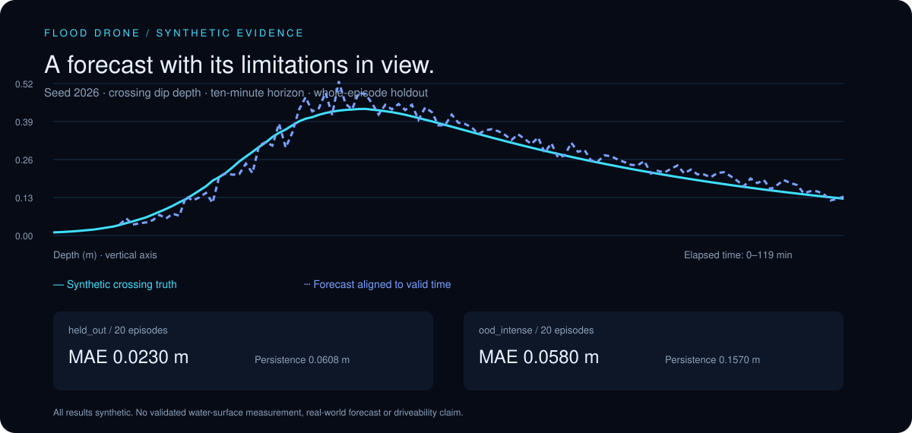
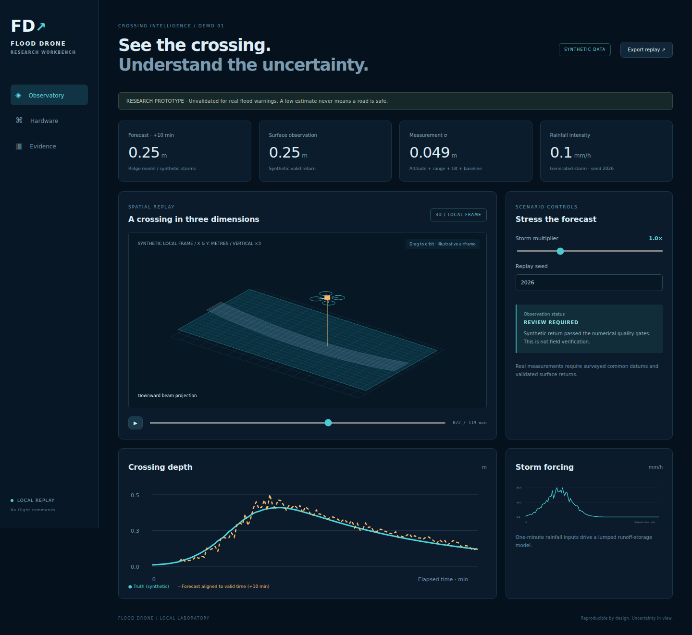
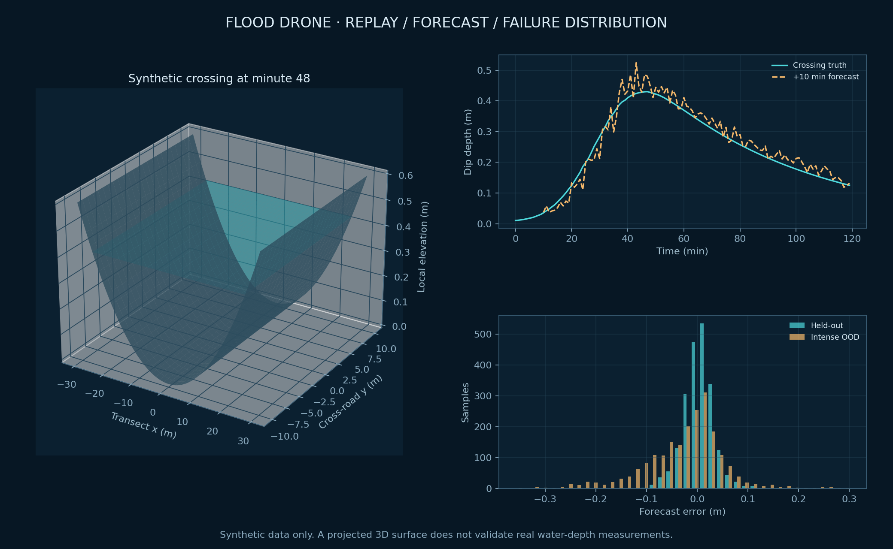

# Problem Statement

[](https://github.com/mirmoosa1014-rgb/flood-drone-research/actions/workflows/ci.yml)

Flood Drone investigates whether an inexpensive aerial sensing stack can make an uncertain road-crossing observation understandable, auditable and reproducible. Inputs are timestamped range, attitude, altitude, road-profile and weather observations. Outputs are quality-gated surface-depth estimates, uncertainty, a ten-minute synthetic crossing forecast and an interactive 3D replay. Success is measured by held-out forecast error and correct rejection of invalid measurements.

**This research prototype has a working synthetic demo. It does not validate real flood depth, issue operational warnings, classify roads as safe, or control a drone.** The local geometry assumes a surveyed common vertical datum, rigid downward sensor and independently validated surface returns. Ordinary GPS plus a single LiDAR return do not establish those conditions.



## A workbench for evidence

- **Spatial observatory:** drag-to-orbit 3D crossing, moving quadcopter and projected range beam; scrub or play the deterministic replay.
- **Traceable measurements:** roll/pitch projection with uncertainty; reject stale, unsynchronized, misaligned, out-of-range, uncertain and unvalidated-water observations.
- **A real small model:** trained ridge regression predicts ten-minute dip depth from current/past virtual gauge/rain inputs. The JSON model embeds feature schema and training episode identities.
- **Paired evaluation:** untouched whole storm episodes, persistence baseline and intense out-of-distribution storms, with every prediction available as CSV.
- **Hardware-aware boundary:** passive MAVLink normalization and optional UDP receiver; camera stream configuration; simulated capability separated from pending bench integration.





The research figure derives from saved numerical outputs. It is not a field survey. The app's interactive canvas uses a geometric 3D projection; its airframe is illustrative rather than validated CAD.

## Run locally

Python 3.11+ and Node 24 suffice. The core simulator, training and fallback HTTP server use Python's standard library. The optional API uses FastAPI.

```bash
cd Flood-Drone
python3 scripts/experiment.py
cd frontend
npm ci
npm run build
cd ..
python3 -m flood_drone.server
```

Open **http://127.0.0.1:8106**. After initial frontend installation, the demo and experiments work offline. `./run.sh` builds missing frontend output and starts the same server. No cloud, paid API, map token or hardware is required.

Optional FastAPI server:

```bash
python3 -m venv .venv
. .venv/bin/activate
python -m pip install -r requirements.txt
python -m uvicorn flood_drone.api:app --host 127.0.0.1 --port 8106
```

For frontend development, start the backend, then run `npm run dev` inside `frontend` and visit http://127.0.0.1:5106 . Vite forwards `/api` to the backend.

## Reproduce and inspect

```bash
python3 -m unittest discover -s tests -v
python3 scripts/experiment.py --quick  # 20 train / 5 held-out / 5 OOD episodes
python3 scripts/experiment.py          # restores delivered full benchmark
cd frontend && npm run build && cd ..
# Optional figure regeneration, with matplotlib and numpy installed:
python3 scripts/figures.py
# Browser checks against the running server:
cd frontend && npx playwright install chromium && npm run test:browser
```

Full training seeds are 0–79; held-out seeds 1000–1019 and intense-storm seeds 2000–2019 never enter training. Each test split has 2,100 origins across 20 whole episodes. Future truth never enters features.

| Synthetic condition | Ridge MAE (m) | Persistence MAE (m) | 95th percentile absolute error (m) |
|---|---:|---:|---:|
| Held-out storms, 1.0× forcing | 0.02297 | 0.06076 | 0.06288 |
| Intense OOD storms, 2.5× forcing | 0.05805 | 0.15700 | 0.18880 |

These results describe a generated lumped reservoir family, not a real watershed. OOD error grows substantially. Both policies use identical origins, observations and ten-minute horizons. See [metrics](results/metrics.json), [per-origin predictions](results/predictions.csv), [replay](results/demo.json), and [model card](docs/model.md).

## Demo in 90 seconds

1. Scrub replay and drag the 3D view to inspect road dip and water plane.
2. Select minute 52 to see a rejected synthetic return instead of numerical depth.
3. Increase storm intensity and compare forcing and forecast curves.
4. Open Hardware and configure a local camera link.
5. Open Evidence, then export replay JSON.

## Validation status

Twenty-eight unit/API/HTTP tests pass, the strict TypeScript/Vite production build passes, and quick/full experiments reproduce the recorded metrics. After recovery into Linux, loopback serving and Chromium headless-shell browser interactions passed. Replay controls, invalid-return display, Hardware/Evidence tabs, camera-link configuration and mobile overflow were checked. The screenshot above is a real running-app capture, inspected for clipping. See [progress](docs/progress.md) for precise recovery and remaining checks. The CI badge below reports hosted verification status. Real hardware, camera stream, flight, water returns and clean Python dependency installation are not verified.

## Hardware limitations and dossier corrections

The supplied wiring guided subsystem naming; exact connector orientation, variant pinout, supply-current margin and firmware parameters remain unverified. No auto-configuration or vehicle commands are implemented. Current ArduPilot guidance lists a TF-Luna serial driver value differing from the dossier; verify against installed firmware rather than copying old numbers.

ESP32-CAM is an image-stream source; no YOLOv8s-seg model is included or claimed to run on it. Water may produce missing/misleading returns, so unvalidated quality defaults to unknown. MSL, ellipsoidal, home-relative and NAVD88 elevations must not be mixed. The custom enclosure, optical window, motors and silicone coatings have no demonstrated IP67 or rain-flight rating here. Thrust, endurance and structural strength also need measured tests. See [hardware notes](docs/hardware.md).

## Documentation

[Architecture](docs/architecture.md) · [Model](docs/model.md) · [Evaluation](docs/evaluation.md) · [Explanation and reviewer questions](docs/explain.md) · [Demo](docs/demo.md) · [Project summary](docs/project-summary.md)

## Technical references

- [ArduPilot Benewake rangefinders](https://ardupilot.org/copter/docs/common-benewake-tf02-lidar.html), consulted 2026-10-25 for ranges, interfaces and current parameter names.
- [MAVLink common messages](https://mavlink.io/en/messages/common.html), consulted for attitude, altitude/range units, coordinate frames and sensor orientation.
- [Espressif esp32-camera](https://github.com/espressif/esp32-camera), consulted for acquisition/HTTP-streaming role. Host-side vision remains future work.

## Contributions and publication

Moosa Mir supplied project direction and hardware context. This implementation, tests, generated model and documentation were produced with substantial AI assistance; review and hardware validation remain necessary. This project does not verify personal code authorship, field results, awards or flight tests. Source and reproducible research evidence are available in the repository linked below.


## Repository

[Source and releases](https://github.com/mirmoosa1014-rgb/flood-drone-research) · [Continuous integration](https://github.com/mirmoosa1014-rgb/flood-drone-research/actions)
